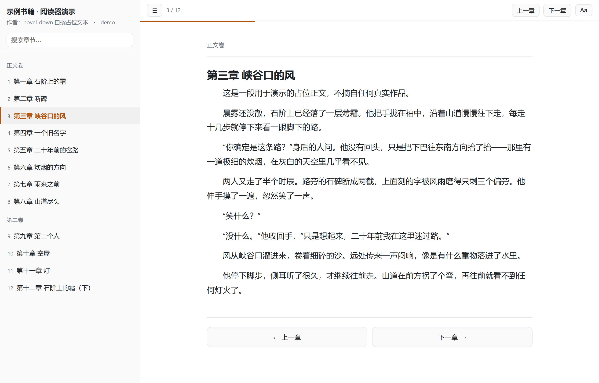

# novel-down · 读书爬虫（仅免费章节）

规则驱动的网络小说离线阅读工具：**目录发现 → 并发抓取 → 免费章节硬拦截 → 校对 → 四格式导出**。

> **本项目仅用于免费章节，不涉及任何 VIP 付费内容。**
> 这不是免责声明，而是[**六层可验证的技术约束**](./docs/FREE_ONLY.md)——
> 无登录、无 Cookie、无购买、无付费墙绕过，且可用 `selfcheck` 机械校验。



*单文件 HTML 阅读器（导出产物之一）。截图内容为脚本自撰的占位文本，非任何真实作品。*

---

## 特性

- **规则驱动**：一个站点一个 JSON，加站不改代码。内置 **161 条**规则（**146 条启用**：
  正版 **37 条**（启用 23）+ **镜像池 124 条**（启用 123）；另有 15 条停用存根）。**含「文库型」站点**
  （虚阁网这类 `分类/集子` 结构的出版书文本库）。规则按池分目录：
  `noveldown/rules/genuine/`（正版）+ `noveldown/rules/mirrors/`（免费镜像），加载器递归读子目录。
- **双路由取页**：纯 HTTP 为主；目录靠 JS 渲染、或站点有 WAF 的，可切**真实浏览器路由**
  （`fetch_mode: browser`，Playwright/Chromium）。**反检测模式**（`browser.anti_detect`）
  用本机**真 Chrome + headed + 关 AutomationControlled + 语言自洽**，可过腾讯云 Chaos VM。
  **且路由可逐段指定**（`book`/`catalog`/`chapter` 各自的 `fetch_mode`）——
  「目录要浏览器、正文是静态 HTML」的站点不必二选一，正文还能保留并发。
  浏览器拆除也做了优化：Playwright 优雅退出在本机要 **47.8~50.4s**，
  改为「先杀本实例进程树再 `pw.stop()`」实测 **0.04s**（豆瓣专栏 3 章 **75.8s → 13.3s**）。
- **两种目录来源**：HTML 选择器，或 **JSON 接口**（`catalog.mode=json_api`）——
  后者常带**逐章 VIP 字段**（七猫 `is_vip`、起点 `sS`），比 HTML class 更可靠；
  支持**卷→章嵌套展开**（`flatten_field`，起点 `data.vs[].cs[]`）。
- **反爬六件套处理**：JS 内联 base64 正文、**字体反爬（PUA 码位，两途径解码）**、
  目录倒序回显、CSS 隐藏列表项、多页目录、**APP 墙**。
- **字体解码零参考字体依赖**：优先按 glyph 名解（秒级）；否则用**随仓**轮廓索引
  （`noveldown/fontmaps/`，459 KB，**不联网、不下载 17 MB 参考字体**）。
- **章节归一化**：全收集 → 去重 → 排序编号（`cid` 升序或 `document_order`），
  统一消解各站目录反爬。
- **免费章节六层拦截**：政策名单 / 规则自证 / 目录 VIP 标记 / 正文付费墙 / 导出终检 / 代码自检。
  站点层不拦"含 VIP"的正版站——拦截在**章节级**（见 [FREE_ONLY.md](./docs/FREE_ONLY.md)）。
- **断点续爬**：章节级缓存（按 cid 索引）+ 状态文件，Ctrl-C 后重跑即续。
- **四格式导出**：TXT / Markdown / **EPUB3（纯标准库手写）** / **单文件 HTML 阅读器**。
- **校对报告**：缺失、乱序、重复、广告残留、异常短章、编码异常、受保护章节。
  「标题重复」会**再判一次正文**：同名且同文才算真重复；同名但不同文单列为
  「标题同名」（多为站点自身命名撞车，**不是**抓取缺陷，也不该当重复去删）。
- **产物终检**：机械验证"受保护内容零请求、零泄漏、无乱码残留"。
- **身份池 + 连接池**：1373 条浏览器身份轮换 + 每线程连接复用（实测约 12× 提速）。
- **零 JS 依赖运行**：`python -m noveldown`，无需浏览器/Node（除非站点用浏览器路由）。

---

## 图形界面（可选）

不想敲命令的话，本项目带一个 **Tkinter 图形界面**（**零第三方依赖**，标准库）：

```bat
python -m noveldown.gui
```

它把主流程接到控件上：**选站点（161 条规则，可搜索）→ 粘 URL → 抓取（实时日志与进度条）
→ 勾选导出格式 → 打开输出目录**。
⚠ 选中站点时会**自动把该站的示例地址填进 URL 框**，可以直接改。

抓取跑在**后台线程**里，界面不会卡死；「停止」会**保存断点**，下次点「开始抓取」即续爬。

⚠ 需要 Python 带 **Tcl/Tk**（本机 `F://Python314` 自带 Tcl/Tk 9）。
若当前环境没有 Tk，启动时会**明确提示并建议改用命令行**，不会静默失败。

打包好的图形版见「发行版」一节（`noveldown-gui.exe`，双击即开、不弹控制台）。


## 快速开始

```bat
cd 本仓（novel-down）

:: 看有哪些站点规则
python -m noveldown sites

:: 规则自检：抓目录 + 抽 1 章，确认规则可用
python -m noveldown probe "https://www.shuquge.com/txt/207266/index.html"

:: 抓整本并导出（先抓 20 章试水）
python -m noveldown fetch "https://www.bqgbe.cc/txt/445/" --limit 20

:: 继续抓完（自动从断点续，不会重抓）
python -m noveldown fetch "https://www.bqgbe.cc/txt/445/"

:: 已抓过的话，换格式重导（不联网）
python -m noveldown export "https://www.bqgbe.cc/txt/445/" --formats epub,html

:: 只看校对报告
python -m noveldown report "https://www.bqgbe.cc/txt/445/"

:: 免费约束机械自检
python -m noveldown selfcheck
```

---

## 命令一览

| 命令 | 作用 |
|---|---|
| `sites` | 列出可用站点规则 |
| `rules [--json]` | 查看规则详情 |
| `probe <url>` | **规则自检**：抓目录 + 抽 1 章，逐环节报命中数 |
| `fetch <url>` | 抓取整本（支持断点续爬）并导出 |
| `export <url>` | 仅从断点/缓存重新导出（不联网） |
| `report <url>` | 仅产出校对报告 |
| `selfcheck` | 免费章节约束的代码级机械自检 |

### `fetch` 选项

| 选项 | 默认 | 说明 |
|---|---|---|
| `--limit N` | 0（全部） | 最多抓 N 章，调试用 |
| `--force` | 关 | 忽略断点，清空缓存重抓 |
| `-o/--out DIR` | `output/` | 输出根目录 |
| `--formats` | `txt,md,epub,html` | 导出格式 |
| `--concurrency N` | 4 | 并发数 |
| `--delay S` | 1.2 | 基础请求间隔秒（另加 0-0.8s 抖动） |
| `--timeout/--retries` | 30 / 3 | 超时与重试 |
| `--proxy` | — | 代理地址 |
| `--curl-cffi` | 关 | 启用 TLS 指纹伪装 |
| `--max-items N` | 8 | 校对报告里最多列几条明细 |
| `--report` | 关 | 配合 `--quiet` 时也强制打印校对报告 |
| `-q/--quiet` | 关 | 安静模式 |

---

## 内置站点规则（2026-09-21 实测）

| 站点 | 类型 | 匹配域名 | 章节数 | 实测结果 |
|---|---|---|---|---|
| **起点中文网** | 正版·含 VIP | `qidian.com` | **1418（153 免费 / 1265 VIP）** | **反检测浏览器路由**过腾讯 Chaos VM；目录走 **JSON 接口**（`data.vs[].cs[]`，逐章 `sS`：1=免费/0=VIP），1265 章标记 locked、**零请求**；抓 17 章 56 932 字，校对 PASS |
| **17K小说网** | 正版 | `17k.com` | **586（全免费）** | 目录 `dl.Volume dd a`；正文 `div#readAreaBox`；20 章 46 058 字；**无字体反爬** |
| **七猫免费小说** | 正版·免费阅读 | `qimao.com` | **708（20 可读 / 688 APP独占）** | 目录走 **JSON 接口**，逐章带 `is_vip`；688 章标记 locked、**零请求**；20 章 43 065 字 |
| **纵横中文网** | 正版·含 VIP | `zongheng.com` | **700（50 免费 / 650 VIP）** | 650 章在**目录层**带 `class="vip col-4"` → 标记 locked、**零请求**；50 章免费正文 163 576 字 |
| **番茄小说** | 正版·免费阅读 | `fanqienovel.com` | 966 | 目录 967 链接→966 章；正文 **362/362 个字体混淆码位全部还原** |
| **塔读小说网** | 正版·免费 | `tadu.com` | **2416（全免费）** | 目录 `/book/catalogue/{bid}`；**正文来自 JSON 接口**（章节页是空壳）→ `chapter.body_api`；3 章 5501 字，校对 PASS |
| **书海小说网** | 正版·含 VIP | `shuhai.com` | **645（40 免费 / 605 VIP）** | 正版详情页 `/book/{bid}.htm`；目录 `?method=getcatalog` **裸 HTML**（无需浏览器）；605 章带 `span.vip` → locked、**零请求**；5 章 11 585 字 |
| **飞卢小说网** | 正版·含 VIP | `faloo.com` | **12188（49 免费 / 12139 VIP）** | 书籍页一次给出全目录（约 2 MB）；免费/VIP 由**分段** `div.DivVip` 判定（逐章无标记）→ 12139 章 locked、**零请求**；3 章 6087 字 |
| **次元姬** | 正版·含 VIP | `ciyuanji.com` | **673（26 免费 / 647 VIP）** | Next.js：目录在 `__NEXT_DATA__`；**无书籍页**，入口为章节页；正文服务端加密、需浏览器渲染；647 章 locked、**零请求**；3 章 10370 字 |
| **哔哩轻小说** | 轻小说译作聚合 | `linovelib.com` | **426（全免费）** | 目录在独立页 `/novel/{bid}/catalog`（按 38 卷组织）；正文 `div#TextContent` **在 HTML 里** → 纯 HTTP；3 章 6484 字 |
| 书趣阁 | 免费阅读站 | `shuquge.com` / `xshuquge.net` | 1582 | 第 1 章 106 段 / 2865 字，过滤 2 行广告 |
| 笔趣阁 bqgbe | 免费阅读站 | `bqgbe.cc` | 169 | 第 1 章 55 段 / 1352 字，base64×33 |
| 笔趣阁 biqu520 | 免费阅读站 | `biqu520.net` | 2653 | 第 1 章 45 段 / 1345 字，base64×23 |
| 速读谷 | 免费镜像 | `shudugu.org` / `sudugu.cc` | 790 | 目录 `div#list`（**新章在前** → `cid_numeric_asc`）；正文 `div.con`；6 章 14957 字，校对 PASS |
| **书山中文网** | 正版·免费 | `shushan.zhangyue.net` | **821（全免费）** | **纯 HTTP**：目录走页面片段接口 `/book/directory?bid=`（0.5 s / 821 条 cid，与页面「目录（821章）」吻合）；正文 `div.art_con`；简介走 `book.info_api`。30 章 **23.2 s** / 94095 字，校对 PASS |
| **潇湘书院** | 正版·免费言情 | `xxsy.net` | **22（全免费）** | **纯 HTTP**：书籍页只给「最新公共章节」→ 目录在独立页 `/chapterlist/{bid}`；卷标记是非锚点 `li`（`volume_selector: ul li:not(:has(a))`）；正文 `div#reader-content` 用 `paragraph_selector` 逐段取（容器里混了登录条/菜单/面包屑）。全量 **20.1 s** / 51231 字，校对 + 终检 PASS |
| **逐浪网** | 正版·免费+VIP 混排 | `zhulang.com` | **129（该书全免费）** | **纯 HTTP、跨子域**：书籍页 `www.zhulang.com/{bid}/`，目录在阅读域 `book.zhulang.com/{bid}/`（静态 129 条）；两处 `h1` 都是站头 → 书名从 `<title>` 清洗、章名取 `div#read-content h2`。全量 **108.7 s** / **556524 字**（站点自述 556479，差 0.01%），校对 + 终检 PASS |
| **仙人掌小说** | 正版·**试读制** | `360kuai-xrz.com`（`360kuai.com` / `look.360.cn`） | **490（10 免费 / 480 VIP）** | **全接口、零浏览器**：目录 `papi.look.360.cn/mlist`（26 页）、正文 `user.360kuai.com/pay/detail`、元数据 `growth.kuaichuan.360kuai.com/info`。⚠ 付费章返回**截断试读**且**无付费提示** → 目录层 `paid` 拦 + 数据源 `unlock` 二次防线。10 章 / 16.9 s / 20782 字，校对 + 终检 PASS；与站点自报 `free_num:10` 吻合 |

| **虚阁网** | 正版·**出版书文本库** | `xuges.com` | **121（红楼梦：作者简介 + 120 回）** | **文库型**：书 ID = `分类/集子` 路径（`gdwx/hlm`），书籍页与目录页同为 `index.htm`；正文 `td:not([class])` 首命中；**多页章回**靠 `continuation_title_pattern` 合并续页（277 项 → 121 章）。全量 **850277 字** / 188s，校对 + 终检 PASS |
**规则按来源分池**（`python -m noveldown sites` 会按池分组列出）：
- **正版**（37 条，23 启用）：起点 / 17K / 七猫 / 纵横 / 番茄 / 塔读 / 书海 / 次元姬 / 飞卢 /
  **红袖读书·小说阅读网（阅文免费线）** / **云起书院** / **创世中文网** / **晋江文学城** / **话本小说** /
  **书山中文网（掌阅系）** / **掌阅小说网移动站**
  **豆瓣阅读·专栏（原创连载）** / **黑岩网** / **潇湘书院（阅文系）** / **逐浪网（连尚文学）** /
  **仙人掌小说（360，试读制）** / **虚阁网（中文出版书文本库·文库型）** /
  **汉典古籍网（经史子集四部·文库型）**
  （+14 条停用存根：刺猬猫 · 息壤 · 有毒 · 寒武纪年 · 米读小说 · 熊猫脑洞小说 ·
  得间免费小说 · 书旗小说（正文加密） · 磨铁 · 微信读书 ·
  当当云阅读（正文位图下发） · 火星小说（正文 hex 密文） ·
  中国哲学书电子化计划（Cloudflare Turnstile 人机验证） ·
  咪咕阅读/咪咕悦看（全站 SPA 壳，目录·正文接口未定位））
  ⚠ **磨铁（laikan）/ 微信读书的正文其实免登录可读**（容器已实测：`div.read-box` / `div.readerChapterContent`），
  但**章列表拿不到**（laikan 是纯 JS 壳且无目录接口；微信读书目录接口需登录）→ 无法枚举章节。
  → 判据：**「正文可读」只是必要条件，「能枚举章节」才是充分条件。**

> ⭐ **「主打出版读物」的平台 ≠ 可做的免费源**（实测结论）：
> 磨铁**按千字计费**、豆瓣阅读/微信读书**阅读需登录** —— 免费可读篇幅极小或为零。
> 遇到同类站先问三件事：① 有没有明码计价（×币/千字）？② 阅读页要不要登录？
> ③ 书籍页是不是「出版电子书」（ISBN / 出版社 / 提供方）？
- **免费镜像**（124 条，覆盖 **392 个镜像域名**）：
  书趣阁 / bqgbe / biqu520 / 哔哩轻小说 /
  搜书网族（搜书网·速读小说·bqg142）/ 速读谷族 / **113 条批量铺开的镜像族**
  （+1 条停用存根：轻之文库已关站）
  → 批量生成的镜像池在 `noveldown/rules/mirrors/`，正版规则在 `noveldown/rules/genuine/`（加载器递归读子目录）

> **为什么镜像站要「尽量铺开」**：盗版站**抽风是通病**（同一 URL 时而 200 时而 reset），
> **源越多整体越可用** —— 同一份内容有 N 个可替换域名，单站抽风时整本书还能抓完。
> 所以池子的意义是「**可替换的等价源集合**」，判据是「**这份备份能不能用**」，
> 而不是「它模板新不新、信息增量大不大」。
> 批量铺开的流水线（书源库 → 存活 → 结构 → 聚类 → 生成 → **引擎复验**）见
> `docs/NEW_SITES_PLAN.md §11.3/§11.4`；工具在 `tools/harvest_book_sources.py`、
> `tools/scan_mirrors.py`、`tools/gen_family_rule.py`、`tools/verify_mirror_rules.py`。
> ⚠ **每个域名都是逐个实测通过的**（目录 ≥20 章 + 正文 ≥300 字，并用真实引擎复验两轮），
> 不是按模板猜测写进 `match` 的。

> **「笔趣阁家族」**：国内最大的盗版阵营就是笔趣阁系——**倒下一个站起来一大片**，
> 同一套模板（`/book/{bid}/` 目录 + `#chaptercontent` 正文）被无数镜像复用，所以本项目把
> 它们收在**一条族规则**里、按域并列（`soushuwang.cc` / `bqg142.cc` / `soduo.cc`），
> 而不是一站一条。这类站**抽风是通病**（同一 URL 时而 200 时而超时），
> 靠重试 + 断点续爬兜住；探测时**不要凭一次失败判死**。

**停用存根共 15 条**（正版 14 + 免费镜像 1，均附可复核证据）。其中 5 条典型：
`ciweimao.com`（刺猬猫，人机验证：章节页 307 → 极验）、
`xrzww.com`（息壤，登录墙：正文接口恒 `{code:401,用户验证失败}`，真 Chrome 也 401）、
`youdubook.com`（有毒小说网，同息壤）、
`hanwujinian.com`（寒武纪年，正文不向未登录下发）、
`linovel.net`（轻之文库，**站点已因版权侵权关闭**）。
详见 [FREE_ONLY.md](./docs/FREE_ONLY.md)。

> **纵横这条最能说明设计取向**：那是一本 705 章的正版小说，其中 **650 章是 VIP**。
> 「站点含 VIP」不是拒绝理由——那 50 章免费内容在射程内；VIP 章由**目录层的 class 标记**
> 拦下，`fetch` 全程只发出 50 次章节请求（已用 `tools/verify_artifacts.py` 机械验证）。

> **起点是天花板级对手**：腾讯云 Chaos VM（`__TENCENT_CHAOS_VM`，95 KB 虚拟机式 JS 挑战）
> 曾判死——捆绑 Chromium + headless 的 `sec-ch-ua` 里明写 `HeadlessChrome`、`navigator.webdriver=true`，
> 202 挑战页 42s 不放行。换成**本机真 Chrome + headed + 关 AutomationControlled** 后，
> 数秒内渲染出 67~70 万字节书页，指纹 `webdriver=false / plugins=5 / languages=zh-CN,zh`。
> 免费/VIP 由目录接口逐章 `sS` 字段切分（**1=免费、0=VIP**，与直觉相反）。

> **七猫的 688 章不是付费墙，是 APP 墙**：web 端只放前 20 章，其余章正文被替换成
> 「下载【七猫免费小说APP】，继续在APP内免费畅读全本内容」。那段占位文字有 78 字，
> **高于最小字数阈值**——不拦就会被当成正常正文存下来。已把「APP 墙」补进第 4 层特征词。

`python -m noveldown sites` 会列出全部规则。

> 新增站点见 [docs/RULES.md](./docs/RULES.md)（含探针工具、五种典型形态的完整 JSON、
> 「**字体反爬**」与「**浏览器路由**」的完整解法）。

---

## 输出结构

```
output/
├── state/<站点>_<书籍ID>.json        进度快照（书名、章节表、状态分布）
├── cache/<站点>_<书籍ID>/<cid>.json  单章缓存（按 cid 索引，重跑不重抓）
└── <书名>_<站点>/
    ├── <书名>_<站点>.txt             纯文本
    ├── <书名>_<站点>.md              Markdown（YAML front matter + 卷/章层级）
    ├── <书名>_<站点>.epub            EPUB3（纯 zipfile 手写）
    ├── <书名>_<站点>.html            单文件离线阅读器
    └── proofread.json                校对报告
```

### 单文件 HTML 阅读器

零依赖、双击即读、可直接拷进手机。带：

- 目录侧栏 + 章节搜索
- 上一章 / 下一章 + 键盘（`←` `→` `j` `k` `空格` `Home` `End`）
- 阅读进度记忆（localStorage 记住当前章与滚动位置）
- 字号 / 行距调节 + 三档主题（日间 / 米黄 / 夜间）

---

## 项目结构

```
novel-down/
├── noveldown/
│   ├── cli.py                 命令行入口
│   ├── engine.py              抓取编排：目录发现 → 并发抓取 → 断点续爬
│   ├── rules.py               规则加载 / 校验 / 匹配
│   ├── rules/*.json           站点规则（一站点一文件）
│   ├── parser.py              目录与正文解析、目录归一化
│   ├── predecode.py           通用预解码器（JS 内联 base64 还原）
│   ├── freeguard.py           免费章节六层拦截 + 代码自检
│   ├── proofread.py           校对
│   ├── state.py               断点续爬（按 cid 索引）
│   ├── models.py              Book / Chapter 模型
│   ├── exporters/             txt / md / epub / htmlreader
│   ├── http_client.py         HTTP 层（复用 webcopier + 连接池改进）
│   ├── identity_manager.py    身份池（复用 webcopier）
│   ├── ratelimit.py           限速器（复用 webcopier + 自适应降速）
│   ├── identities.json        1373 条浏览器身份
│   ├── fontmaps/              随仓字体轮廓索引（459 KB，零下载解密用）
│   └── constants.py           常量 + 免费约束词表
├── tools/probe_site.py        站点结构探针（编写新规则用；含「正文真实性检查」）
├── tools/build_fontmap.py     重建字体轮廓索引（仅维护者；--shipped 写回随仓索引）
├── tools/verify_artifacts.py  产物终检（零请求 / 零泄漏 / 无乱码残留）
├── tools/verify_reader.py     真实浏览器验证 HTML 阅读器（Playwright）
├── tools/make_screenshot.py   生成 README 演示截图（用自撰文本，不含第三方正文）
├── tools/hunt_api.py          「接口猎手」：真浏览器 + 监听网络请求，挖目录/正文接口
├── tools/import_chinese_philosophy.py  「中国哲学书电子化计划」离线数据集导入（零网络）
├── tools/check_official.py    「作家入口」校验：用有无创作/投稿入口交叉验证站点归类
├── tools/check_repo.py        仓库卫生门禁（本仓不含第三方源码 / 凭据 / 产物）
├── tests/                     353 个用例（含端到端拦截集成测试）+ fixtures
├── docs/
│   ├── REFERENCE.md           借鉴记账（来源 + 许可证 + 范围 + 排除项）
│   ├── RULES.md               规则格式与典型形态（含字体反爬 / 浏览器路由）
│   └── FREE_ONLY.md           免费章节六层约束
└── output/                    产物（不入版本库）
```

---

## 依赖

**必需依赖只有 `requests` + `beautifulsoup4`**（EPUB/HTML 导出为纯标准库实现）：

```bat
python -m pip install -r requirements.txt
```

| 包 | 用途 | 必需 |
|---|---|---|
| `requests` | HTTP | ✓ |
| `beautifulsoup4` | HTML 解析 | ✓ |
| `lxml` | bs4 的快速解析器（缺失自动回退 `html.parser`） | 建议 |
| `soupsieve` | CSS 选择器（随 bs4 安装） | ✓ |
| `fontTools` + `brotli` | **字体反爬解码**（番茄小说）——不装只影响该类站点；解码所需的轮廓索引已随仓，**运行时不需要参考字体、不联网** | 可选 |
| `playwright` | **浏览器路由 / 反检测模式**（目录靠 JS 渲染、或有 WAF 的站点）——不装只影响该类站点；反检测还需本机装有 Google Chrome | 可选 |
| `curl_cffi` | TLS 指纹伪装（`--curl-cffi`） | 可选 |

实测本机 本机 Python（Python 3.14.7）上述依赖**全部可用**。

### 环境变量

| 变量 | 作用 |
|---|---|
| `NOVELDOWN_STEALTH_JS` | 可选：自备 stealth 脚本（如 puppeteer-extra 的 `stealth.min.js`）路径。反检测模式会在页面脚本前注入它。**本项目不随仓分发该脚本**（实测内置伪装已足够，理由见 [docs/REFERENCE.md](./docs/REFERENCE.md) 第六节） |

---

## 测试

```bat
python -m unittest discover -s tests -t .
```

**353 个用例，约 6 秒**（离线，不联网）。覆盖：预解码（含真实页面回归）、
目录归一化（含 `document_order`/`keep_last`）、目录页发现、正文提取、
免费六层拦截、四格式导出（含 EPUB 结构与 XML 合法性校验）、
断点续爬状态机、规则校验、校对报告、字体反爬解码（glyph 名 / 轮廓索引）、
JSON 接口目录（含 `flatten_field` 卷→章展开、**内嵌 HTML 的 SSR 数据块**）、
段落级正文选择器（含**未命中回退**、**首段即标题**的精确删除）、
反检测启动参数与语言自洽、容器式目录项（含空 `<a>` 文本）、子元素/分段 VIP 判定、
正文接口 `body_api`（含水印剔除）、作者正则、书名清洗。

另有四项**端到端**验证：

```bat
:: 1. 真实引擎 + 本地合成站点：证明「locked 章节零请求」「付费墙正文被丢弃」
::    「导出拒绝」「成品无付费字样」——随单测一起跑
python -m unittest tests.test_integration_guard -v

:: 2. 真实浏览器（Playwright + Chromium）操作 HTML 阅读器并断言 30 项
python tools\verify_reader.py "output\<书名>_<站点>\<书名>_<站点>.html"

:: 3. 产物终检：受保护内容零请求 / 零泄漏 / 无乱码残留
python tools\verify_artifacts.py "output\<书名>_<站点>"

:: 4. 仓库卫生门禁：不含第三方源码 / 凭据 / 产物，借鉴记账完整，
::    且「文档里读作现状的内容」与代码事实一致（README 计数 / §12.6 规划表状态）
python tools\check_repo.py
python tools\check_repo.py --selfcheck   # 证明门禁本身有效
```

---

## 注意事项

- **版权**：抓下的内容版权归原作者与发布方所有，仅供个人离线阅读，不得再分发或商用。
- **礼貌抓取**：默认并发 4、间隔 1.2s±0.8s；遇 403/412/429/503 自动全局降速。
  抓一本 2653 章的书约需 1.5 小时（含限速）。
- **站点改版**：规则会失效。用 `probe` 定位是哪一环断了，或重跑 `tools/probe_site.py`。
- **本机文件系统较慢**（实测创建+写+删一个目录约 1.5s，疑似杀软实时扫描），
  单测已改为共享临时目录以避免 I/O 成为瓶颈。

## 发行版（可执行程序）

除源码运行外，本项目也提供**便携版**与**安装版**，构建方法与踩坑清单见
[packaging/README.md](./packaging/README.md)。

| 产物 | 形态 | 说明 |
|---|---|---|
| `noveldown-0.8.40-portable-win64.zip` | **便携版（目录）** | 解压即用，启动约 **1.4 秒**（推荐） |
| `noveldown-onefile.exe` | **便携版（单文件）** | 单个 exe；⚠ 每次启动约 **40 秒**（解包 + 杀软实时扫描） |
| `novel-down-0.8.40-win64.msi` | **MSI 安装版** | 开始菜单 / PATH / 卸载项 |

自己构建（在本仓根目录）：

```bat
F:/Python314/python.exe packaging/build.py --all
```

⚠ 发行版按**最小依赖**打包（`requests` + `beautifulsoup4` + `lxml`），
**不含**浏览器路由（需 playwright）与字体反爬解码（需 fontTools）——
需要这些能力请用**源码方式**运行，见「依赖」一节。

## 与 crawl-hub 的接入（B 模式插件，2026-09-22）

本仓同时作为 [`crawl-hub`](https://gitee.com/siwpan/crawl-hub) 聚合启动器（本机 `G:\repos\crawl-hub`）的
**B 模式插件**接入：hub 只做「展示 + 启动 + 停止」，以子进程拉本仓 GUI（cwd = 本仓），
**不 import 本仓任何逻辑**（聚合不融合）。新增/移除工具只改 hub 的 `crawlers.json`。

| 本仓文件 | 作用 |
|---|---|
| `run_gui.py` | **文件级入口薄壳**：把仓根塞进 `sys.path` 后转交 `noveldown.gui.main`。GUI 本体是**包模块**（只支持 `python -m noveldown.gui`），而 hub 的 `entry` 约定是「工具目录下的**文件**」+ `python <entry>`（cwd = 工具目录）；此壳只做这一件事，不复制任何 GUI 逻辑 |
| `manifest.json` | 插件清单：`name` / `version` / `entry` / `interface`（discover、fetch、extract、transform）+ `config` 键值提示。**刻意不声明 `kit` 依赖**——本仓不 import `crawler-kit`（反爬三件为内联副本，见下） |

两条入口等价，任选：

```bat
python run_gui.py           :: 宿主 / crawl-hub 用（cwd = 本仓）
python -m noveldown.gui     :: 手动用
```

> 依赖由**宿主的解释器**提供（hub 的 `python: auto`）：`requests` + `beautifulsoup4` 为必需，
> `lxml` / `fontTools`+`brotli` / `playwright` / `curl_cffi` 按需（缺了只影响对应站点，见「依赖」一节）。

## 许可

MIT，见 [LICENSE](./LICENSE)。

**第三方来源**：本项目在调研阶段参照过三个第三方项目（FictionDown / 404-novel-downloader /
backupqidian），**只借鉴设计思路，未复制任何代码**，其源码**不入本仓**

> ⚠ **这句话的边界要说清**（审计 #17）：`tools/check_repo.py` 能机械证明的是
> 「**仓里不含第三方源码树**」+「借鉴记账完整」——它**不能**证明「零行复制」
> （往里抄几行是实现层的事，路径/文件名门禁看不出来）。所以准确的表述是：
> **门禁保证「不随仓分发第三方源码」，不保证「没有任何行级借鉴」。**
（其中两份是 GPL-3.0 与 AGPL-3.0-or-later，与本仓 MIT 不兼容）。
浏览器反检测所用的 `puppeteer-extra-plugin-stealth`（MIT）经评估后**未随仓分发**
（实测内置伪装已足够，仅保留可选外挂入口）。
来源链接、许可证依据、取用范围与排除项逐条记在 [docs/REFERENCE.md](./docs/REFERENCE.md)，
并由 `tools/check_repo.py` 机械校验「本仓不含第三方源码」＋「借鉴记账完整」。
